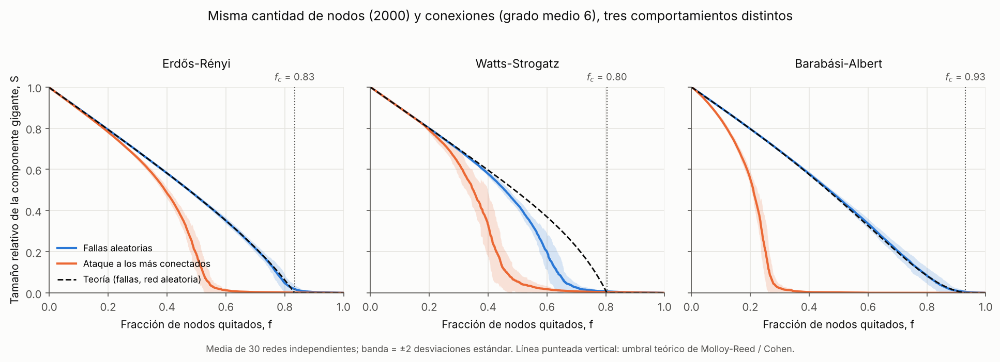
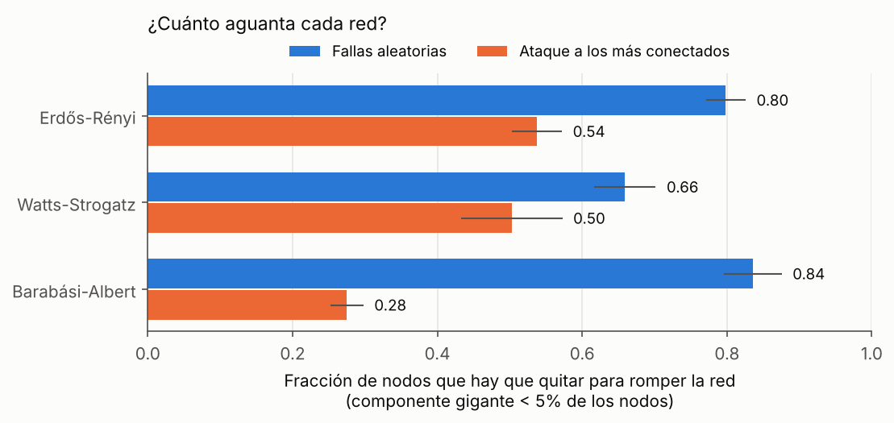

# Robustez de redes: ¿fallas aleatorias o ataques dirigidos?

Tres redes con **el mismo número de nodos (2000) y el mismo número de conexiones (grado medio 6)**.
La única diferencia es la regla con que se conectan. ¿Se rompen igual cuando se les quitan nodos?

**No.** La red con *hubs* (Barabási-Albert) es la más resistente a fallas al azar y la más frágil ante un ataque:
hay que quitar el **84 %** de sus nodos al azar para desarmarla, pero basta con el **28 %** si se eligen los más conectados.



## Resultados

Fracción de nodos que hay que quitar para que la componente gigante caiga por debajo del 5 % de la red
(media ± desviación estándar sobre 30 redes independientes por familia):

| Red | κ = ⟨k²⟩/⟨k⟩ | f_c teórico (fallas) | f_c simulado (fallas) | f_c simulado (ataque) |
|---|---|---|---|---|
| Erdős-Rényi | 7.0 | 0.83 | 0.80 ± 0.01 | 0.54 ± 0.02 |
| Watts-Strogatz | 6.1 | 0.80 | 0.66 ± 0.02 | 0.50 ± 0.04 |
| Barabási-Albert | 15.5 | 0.93 | 0.84 ± 0.02 | 0.28 ± 0.01 |



## Lectura

1. **El grado medio no predice la robustez.** Las tres redes tienen ⟨k⟩ = 6 y se comportan distinto.
   Lo que manda es el segundo momento ⟨k²⟩, que crece con la cola de la distribución de grados.
2. **La teoría de percolación acierta donde sus supuestos se cumplen.** Para fallas aleatorias se usa
   el criterio de Molloy-Reed y la fracción crítica de Cohen et al., f_c = 1 − 1/(κ − 1), con la curva
   completa S(f) calculada con funciones generatrices a partir de la distribución de grados real de cada red.
   En Erdős-Rényi y Barabási-Albert la curva teórica cae encima de la simulación.
3. **Watts-Strogatz se aparta de la teoría, y eso es informativo.** La teoría supone una red localmente
   en forma de árbol. Watts-Strogatz tiene agrupamiento alto (≈ 0.45): muchas conexiones cierran triángulos
   y son redundantes, así que aportan menos a la conectividad global de lo que la teoría les acredita.
   La red se rompe antes (0.66 contra 0.80).
4. **La paradoja de los hubs.** Los nodos muy conectados hacen la red casi inmune a fallas al azar
   (es muy improbable acertarle a uno) y a la vez son su talón de Aquiles ante un ataque.

## Método

- **Simulación:** algoritmo de Newman-Ziff (2000). En lugar de quitar nodos uno a uno y recalcular
  la componente gigante (≈ N² operaciones), se recorre el proceso al revés agregando nodos y uniendo
  clusters con *union-find*, casi lineal en N. Las pruebas comparan el resultado contra la fuerza bruta
  de NetworkX y coinciden exactamente.
- **Ataque:** por grado **inicial** (no se recalcula tras cada remoción); los empates se rompen al azar.
- **Incertidumbre:** 30 realizaciones independientes de cada red y de cada orden de remoción;
  bandas de ±2 desviaciones estándar.
- **Teoría:** u = 1 − q + q·G₁(u), S = q·(1 − G₀(u)), con q = 1 − f la fracción de nodos que sobreviven.

## Limitaciones

- **Tamaño finito.** El umbral simulado queda por debajo del teórico, sobre todo en Barabási-Albert:
  con N = 2000 la transición se suaviza y el criterio de "< 5 %" la detecta antes. Para N → ∞ y una
  ley de potencia con exponente 3, f_c teórico tiende a 1.
- **Umbral operativo.** El 5 % es una convención; otra elección mueve los números pero no el orden.
- **Ataque estático.** Recalcular el grado después de cada remoción (ataque adaptativo) rompe la red aún más rápido.
- **Redes sintéticas.** El paso natural es aplicarlo a una red real (transporte, energía, comercio).

## Reproducir

```bash
python -m venv .venv && source .venv/bin/activate
pip install -r requirements.txt
python -m pytest            # pruebas: algoritmo rápido vs fuerza bruta, teoría vs resultados conocidos
python src/experimento.py   # ~20 s en un portátil; regenera figures/ y results/
```

El recorrido explicado paso a paso está en `notebooks/robustez.ipynb`.

## Referencias

- Molloy, M. & Reed, B. (1995). A critical point for random graphs with a given degree sequence. *Random Structures & Algorithms*.
- Albert, R., Jeong, H. & Barabási, A.-L. (2000). Error and attack tolerance of complex networks. *Nature*.
- Callaway, D. S., Newman, M. E. J., Strogatz, S. H. & Watts, D. J. (2000). Network robustness and fragility: percolation on random graphs. *Physical Review Letters*.
- Cohen, R., Erez, K., ben-Avraham, D. & Havlin, S. (2000). Resilience of the Internet to random breakdowns. *Physical Review Letters*.
- Newman, M. E. J. & Ziff, R. M. (2000). Efficient Monte Carlo algorithm and high-precision results for percolation. *Physical Review Letters*.
